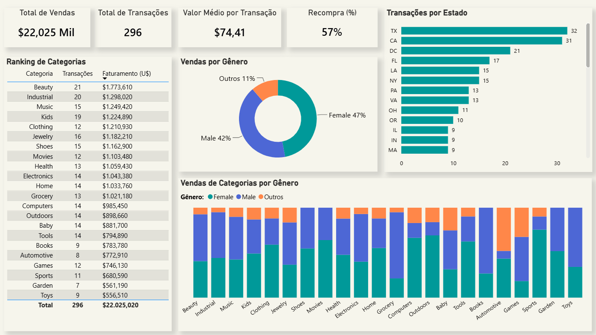
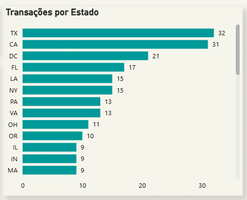
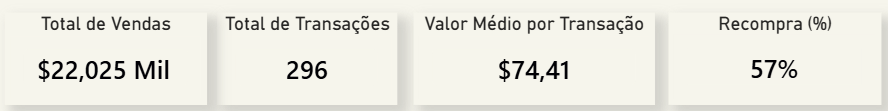

# Power BI | Dashboard Transações E-commerce  

*[Click here for the English version](README-en.md)*

### Dashboard no Power BI com KPIs e gráficos interativos com dados de transações de um e-commerce dos EUA. 

  

### Objetivo do Projeto: 
O projeto teve por objetivo apresentar os principais indicadores e gráficos com dados provenientes de uma base de transações de vendas de um e-commerce dos EUA. O dataset abrange informações de categorias dos produtos vendidos, seus valores (em dólares americanos), o estado onde a venda ocorreu, além de dados referentes aos compradores, como gênero e profissão.  

  

### Principais Desafios: 
Tratei a base no Power Query e criei medidas para gerar os KPIs. Para o indicador de recompra, por exemplo, utilizei fórmula para calcular o valor da contagem de clientes únicos pela quantidade total de transações, e a partir do resultado, encontrar o percentual de clientes que compraram mais de uma vez.  

  

O painel permite ainda levantar informações relevantes como por meio da tabela de categorias mais vendidas, permitindo ranquear por número de transações ou por faturamento, além de visualização em barras das categorias agrupadas por compras de acordo com o gênero.  

A respeito de gênero, um gráfico é dedicado somente a mostrar as transações gerais por sexo, e, para evidenciar os estados com mais vendas, incluí uma visualização de barras horizontais exibindo também o número de transações realizadas em cada localidade.

